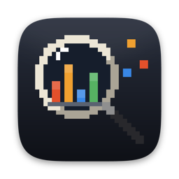
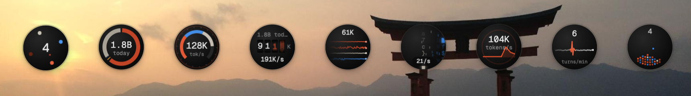
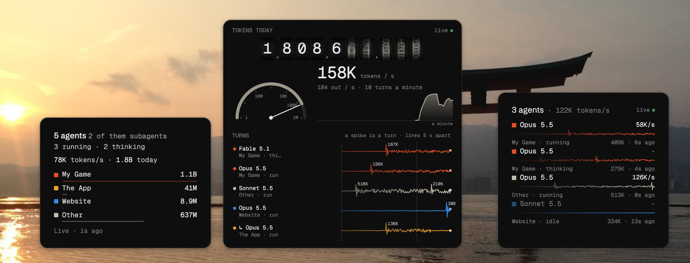
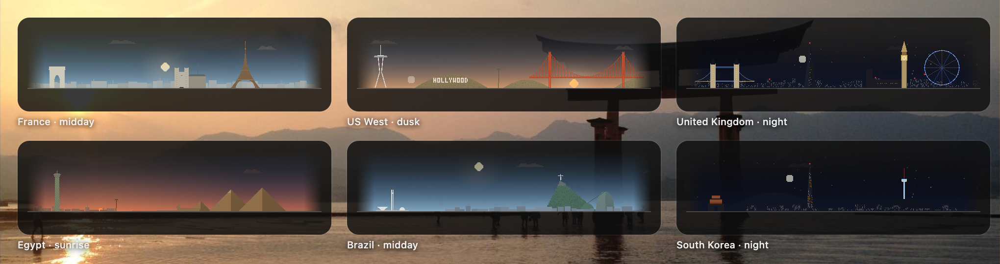

  

<h1 align="center">Tokiscope</h1>

  <b>Watch your coding agents work.</b> 
  A little bubble on your Mac's desktop that turns the tokens of Claude Code, Codex and Grok into pixel art, 
  live, as they're spent.

  <a href="https://github.com/kcazin/tokiscope/releases/latest"><b>Download for macOS</b></a>
  &nbsp;·&nbsp; macOS 13 or later &nbsp;·&nbsp; free and open source

  

## A bubble in the corner

Tokiscope sits in a corner of your screen as a small ball, out of the way. While your agents work it moves with them:
a counter rolls, a needle climbs, a trace kicks each time a turn lands. Pick the bubble you like.

  

## Click it open

Click the bubble and it opens into more: what each agent is doing and on which project, how fast the tokens go, and
each project's share of the day. Or the trucks: every token today becomes a square on a pile, and a little truck
hauls it to the project it went to. Cranes, a sorting belt and silos are there too.

  

## Under your sky

The trucks work under the sky where you are, by your country's landmarks: the sun and moon move with your clock, from
dawn to night. Twenty places, from Tokyo to San Francisco.

  

## All your machines in one place

Agents on your laptop, your desktop and a Linux box all show in the same bubble. Install Tokiscope on another Mac and
join the first one (both show the same four digits, you approve), or add a Linux machine from Settings over SSH.
Each Mac keeps everyone's stats, so the bubble stays complete while the others sleep.
[More on machines](docs/MACHINES.md).

## Install

1. [Download the latest DMG](https://github.com/kcazin/tokiscope/releases/latest) and drag Tokiscope to Applications.
2. Open it. That's all: it starts counting this Mac's agents and opens Settings once to say hello.

Tokiscope updates itself. The menu bar item (or a right click on the bubble) shows today's tokens at a glance, hides
the bubble and opens Settings, where you choose the bubble, what it opens into and which tokens count.

## Your stats stay yours

The counting is done by [agent-stats](https://github.com/kcazin/agent-stats), which ships inside the app. It reads
your agents' logs on your own machines and keeps the totals there: nothing is sent anywhere unless you set it up.
Out of the box, only this Mac can reach its stats.

## For developers

How it's built, how to work on the pages and how releases are made: [docs/DEVELOPMENT.md](docs/DEVELOPMENT.md).

GPL-3.0-or-later: see [LICENSE](LICENSE). You may use, change and share Tokiscope; whatever you distribute that
builds on it must be under the GPL too, with its source. It ships [agent-stats](https://github.com/kcazin/agent-stats)
(GPL-3.0-or-later) and [Sparkle](https://sparkle-project.org) (MIT, its license in the app as `Sparkle-LICENSE`).
